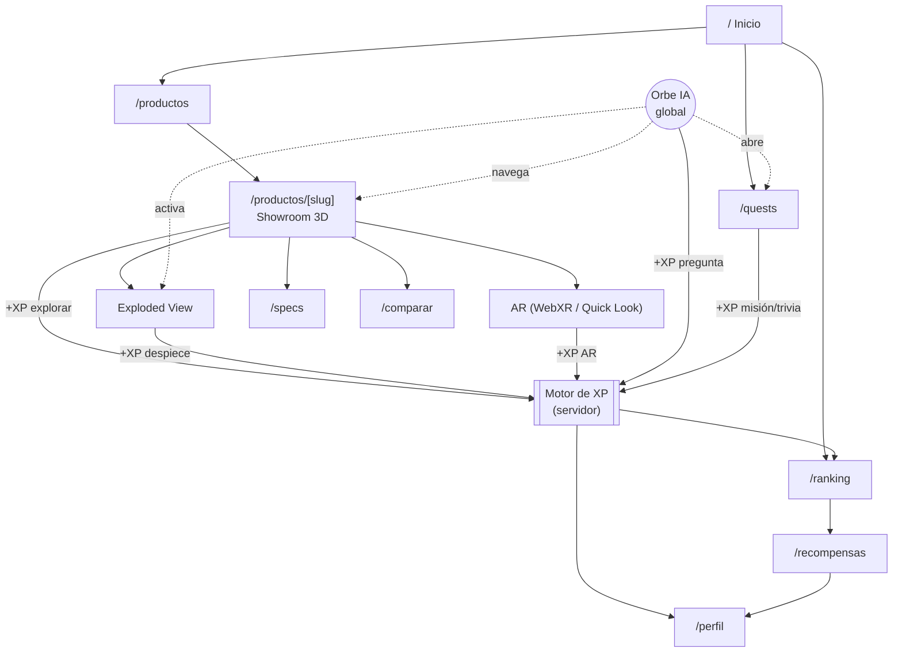
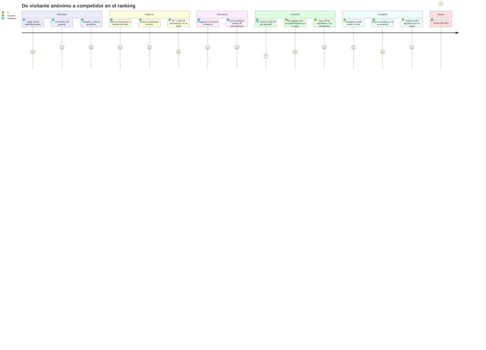
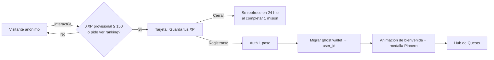
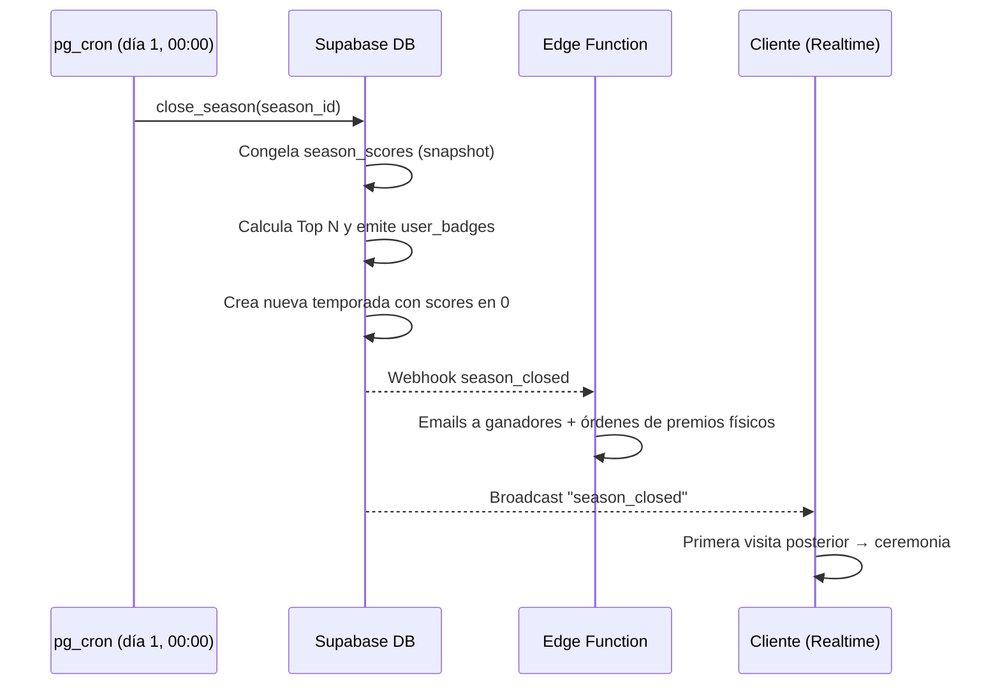
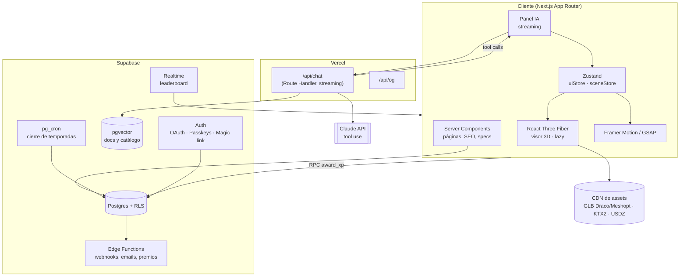

# Gallardo Tech — Propuesta de Diseño, UX y Arquitectura

> Plataforma web oficial · Showroom 3D · Asistente IA · Gamificación "Tech Quests"
> Versión 1.0 — Octubre 2026

---

## Índice

0. [Principios rectores](#0-principios-rectores)
1. [Dirección visual y sistema de diseño](#1-dirección-visual-y-sistema-de-diseño)
2. [Mapa del sitio (Sitemap)](#2-mapa-del-sitio-sitemap)
3. [Wireframes y estructura de UI](#3-wireframes-y-estructura-de-ui)
4. [Flujo de usuario (User Journey)](#4-flujo-de-usuario-user-journey)
5. [Animaciones, microinteracciones y premiación](#5-animaciones-microinteracciones-y-premiación)
6. [Reglas de gamificación](#6-reglas-de-gamificación)
7. [Arquitectura técnica](#7-arquitectura-técnica)
8. [Presupuesto de rendimiento](#8-presupuesto-de-rendimiento)
9. [Hoja de ruta por fases](#9-hoja-de-ruta-por-fases)

---

## 0. Principios rectores

| Principio | Qué significa en la práctica |
|---|---|
| **El producto es el héroe** | El 3D ocupa el centro visual; la UI de cristal flota alrededor y se aparta cuando el usuario explora. |
| **Valor antes de registro** | El usuario anónimo puede explorar, hablar con la IA y *ganar XP provisional*. El registro sirve para **conservar** lo ganado, no para desbloquear la web. |
| **Cada acción tiene eco** | Toda interacción relevante responde con luz, movimiento, sonido o vibración (siempre opcional y desactivable). |
| **Rápido primero, 3D después** | La primera pintura es HTML estático + póster del producto; el motor 3D se hidrata sólo cuando hace falta. |
| **Justo y verificable** | Los puntos se calculan en el servidor. El cliente sólo *celebra*; nunca *decide* cuántos XP hay. |
| **Accesible por defecto** | `prefers-reduced-motion`, contraste AA, navegación por teclado completa, alternativa textual a cada vista 3D. |

---

## 1. Dirección visual y sistema de diseño

### 1.1 Concepto: "Minimalismo de producto" (estilo Apple)

> Dirección actualizada en octubre de 2026: se reemplaza el neón oscuro por una paleta monocromática blanca, negra y gris.

Bandas a ancho completo que alternan blanco, gris claro y negro. Texto centrado, titulares grandes y cortos, y el producto como imagen principal. El color lo ponen los acabados del producto (Medianoche, Plata, Blanco), no la interfaz.

### 1.2 Paleta

| Token | Valor | Uso |
|---|---|---|
| `--bg` | `#ffffff` | Fondo principal |
| `--bg-alt` | `#f5f5f7` | Bandas y tarjetas secundarias |
| `--ink` | `#1d1d1f` | Titulares y texto principal |
| `--ink-2` | `#6e6e73` | Texto secundario |
| `--ink-3` | `#86868b` | Metadatos |
| `--line` | `#d2d2d7` | Divisores |
| Banda oscura | `#000000` / `#f5f5f7` | Showroom y bloques destacados; redefine los mismos tokens |
| `--error` | `#d70015` | Sólo mensajes de error |

El XP, los niveles y el ranking usan el mismo negro y gris: el énfasis viene del tamaño y el peso tipográfico, no del color.

### 1.3 Tipografía

| Rol | Fuente | Tamaños (desktop / móvil) |
|---|---|---|
| Display | **SF Pro Display** (sistema) / Inter 600 | 80 / 40 px, tracking −1.5 % |
| Títulos | SF Pro / Inter 600 | 56 / 32, 21 px |
| Cuerpo | SF Pro Text / Inter 400 | 17 px, line-height 1.47 |
| Datos | Misma familia con cifras tabulares | 15–56 px |

En dispositivos Apple se usa la fuente del sistema; en el resto, Inter vía `next/font` (self-hosted, `display: swap`).

### 1.4 Receta de cristal (Glassmorphism avanzado)

```css
.glass {
  background: var(--glass);
  backdrop-filter: blur(24px) saturate(140%);
  border: 1px solid var(--glass-border);
  border-radius: 24px;
  box-shadow:
    inset 0 1px 0 rgba(255,255,255,0.06),   /* reflejo superior */
    0 20px 60px -20px rgba(0,0,0,0.6);      /* profundidad */
}
.glass--active { box-shadow: 0 0 0 1px var(--accent), 0 0 32px -8px var(--accent); }
```

- **Capas de profundidad:** `z0` escena 3D/fondo → `z1` tarjetas bento → `z2` paneles flotantes (IA, HUD XP) → `z3` modales y celebraciones.
- **Luz que sigue al cursor:** gradiente radial de 400 px anclado a `--mx/--my` sobre cada tarjeta bento (desactivado en táctil).
- **Fallback:** sin soporte de `backdrop-filter` o en gama baja → fondo sólido `#121722` al 92 %.

### 1.5 Bento Grid

- Desktop: 12 columnas, gutter 16 px, celdas de 1×1, 2×1, 2×2 y 4×2.
- Tablet: 6 columnas. Móvil: 2 columnas con tarjetas apiladas y celdas 2×1 dominantes.
- Las celdas no son decorativas: cada una es un **punto de entrada** (producto, misión, IA, ranking).

### 1.6 Sonido y háptica

| Evento | Sonido (≤ 40 KB, Web Audio) | Háptica (`navigator.vibrate`) |
|---|---|---|
| Hover/selección | "tick" cristal, −24 dB | — |
| Cambio de variante | barrido suave | 10 ms |
| +XP | campanilla ascendente | 15 ms |
| Subida de nivel | acorde de 3 notas | patrón `[20, 40, 20]` |
| Misión completada | "sello" grave | 30 ms |

Sonido **apagado por defecto**; un toggle en el HUD lo activa y se recuerda en `localStorage`.

---

## 2. Mapa del sitio (Sitemap)

### 2.1 Árbol jerárquico (rutas Next.js App Router)

```
/                                   Inicio (hero 3D + bento de entradas)
├── /productos                      Catálogo (bento filtrable)
│   └── /productos/[slug]           Showroom 3D del producto
│       ├── ?vista=despiece         Exploded View
│       ├── ?variante=[id]          Acabado/color activo
│       └── /productos/[slug]/specs Ficha técnica completa (SEO)
├── /comparar?ids=a,b               Comparador lado a lado (2 visores sincronizados)
├── /quests                         Hub de gamificación
│   ├── /quests/diarias
│   ├── /quests/semanales
│   └── /quests/trivia              Trivia técnica semanal
├── /ranking                        Leaderboard en vivo
│   ├── /ranking/semanal
│   ├── /ranking/mensual
│   └── /ranking/historico          Ganadores de temporadas pasadas
├── /recompensas                    Catálogo de premios y reglas del ciclo
├── /perfil                         (privado)
│   ├── /perfil/medallas            Vitrina de medallas permanentes
│   ├── /perfil/historial           Registro de XP
│   └── /perfil/ajustes             Sonido, háptica, privacidad, notificaciones
├── /soporte                        Centro de ayuda (indexado por la IA)
│   └── /soporte/[articulo]
├── /empresa                        Sobre nosotros, prensa, carreras
├── /entrar · /registro             Auth (también disponible como modal)
└── /legal/(terminos|privacidad|bases-concurso)

Global (presente en todas las rutas)
├── HUD de XP (nivel, barra, racha)  — esquina superior derecha
├── Orbe de IA flotante              — esquina inferior derecha
└── Toast de misiones                — esquina inferior izquierda
```

### 2.2 Diagrama de navegación y gamificación



---

## 3. Wireframes y estructura de UI

> Convención: `[ ]` botón · `{ }` componente 3D · `( )` orbe/indicador · `▓` área de cristal.

### 3.1 Inicio — Escritorio (1440 px)

```
┌──────────────────────────────────────────────────────────────────────────────┐
│ ◆ GALLARDO TECH   Productos  Quests  Ranking  Soporte     ⚡Lv7 ▓▓▓▓░ 🔥5  [Entrar]│  ← nav cristal, 64px
├──────────────────────────────────────────────────────────────────────────────┤
│                                                                              │
│   EL FUTURO                         {                                }       │
│   SE PUEDE TOCAR.                   {   Producto estrella en 3D      }       │  ← hero 100vh
│                                     {   rotación lenta + glow        }       │
│   Subtítulo de una línea.           {   (póster AVIF hasta hidratar) }       │
│   [Explorar en 3D]  [Ver misiones]  {                                }       │
│                                                     ● ○ ○  selector modelos  │
├──────────────────────────────────────────────────────────────────────────────┤
│ ▓▓▓▓▓▓▓▓▓▓▓▓▓▓▓▓▓▓▓▓▓▓▓▓▓▓▓ │ ▓▓▓▓▓▓▓▓▓▓▓▓▓▓ │ ▓▓▓▓▓▓▓▓▓▓▓▓▓▓▓▓▓▓▓▓▓▓▓ │
│ ▓ Producto X (2×2)          ▓ │ ▓ Misión del día▓ │ ▓ Leaderboard (2×2)    ▓ │
│ ▓ mini-visor 3D             ▓ │ ▓ +250 XP  ▓▓░  ▓ │ ▓ 1. @quasar   12 400 XP ▓ │
│ ▓                           ▓ │ ▓ [Empezar]     ▓ │ ▓ 2. @kai    11 980    ▓ │
│ ▓                           ▓ ├─────────────────┤ │ ▓ 3. @lumen  10 200    ▓ │
│ ▓                           ▓ │ ▓ Pregunta a IA ▓ │ ▓ ⏱ Cierra en 2d 14h   ▓ │
│ ▓                           ▓ │ ▓ "¿Qué modelo…"▓ │ ▓                      ▓ │
├───────────────┬───────────────┴─────────────────┴──┬──────────────────────────┤
│ ▓ Producto Y  ▓ │ ▓ Despiece técnico (4×1)          ▓ │ ▓ Premio del mes (2×1)  ▓ │
│ ▓ (1×1)       ▓ │ ▓ animación al hacer scroll       ▓ │ ▓ hardware exclusivo    ▓ │
└───────────────┴────────────────────────────────────┴──────────────────────────┘
                                                                         ( ◉ )  ← orbe IA
```

### 3.2 Inicio — Móvil (390 px)

```
┌──────────────────────────┐
│ ◆ GT        ⚡7 🔥5  ☰   │  nav compacta
├──────────────────────────┤
│  {                    }  │
│  {  Producto 3D       }  │  hero 70vh, gesto de
│  {  (drag = rotar)    }  │  arrastre horizontal
│  EL FUTURO SE PUEDE      │
│  TOCAR.                  │
│  [ Explorar en 3D     ]  │  CTA ancho completo
├──────────────────────────┤
│ ▓ Misión del día  +250 ▓ │  tarjeta 2×1
│ ▓ ▓▓▓▓▓░░░  [Empezar]  ▓ │
├────────────┬─────────────┤
│ ▓ Prod. X ▓│▓ Prod. Y  ▓ │  1×1 + 1×1
├────────────┴─────────────┤
│ ▓ Top 3 · tú: #42  ⏱2d ▓ │
├──────────────────────────┤
│ Inicio Productos Quests  │  tab bar inferior
│  ⌂       ◇        ★   👤 │  (zona del pulgar)
└──────────────────────( ◉ )┘  orbe IA sobre la tab bar
```

### 3.3 Showroom 3D del producto — Escritorio

```
┌──────────────────────────────────────────────────────────────────────────────┐
│ ← Productos / Modelo X                                   ⚡Lv7 ▓▓▓▓░ 🔥5      │
├───────────────┬──────────────────────────────────────────────┬───────────────┤
│ ▓ VARIANTES  ▓│                                              │▓ ESPECIFIC.  ▓│
│ ▓ ● Obsidian ▓│                                              │▓ CPU   X1    ▓│
│ ▓ ○ Glacier  ▓│        {                            }        │▓ RAM   32 GB ▓│
│ ▓ ○ Ember    ▓│        {   Canvas R3F a pantalla     }  ◎ ← hotspot  │▓ Batería 20h ▓│
│ ▓            ▓│        {   completa (detrás de UI)  }        │▓ Peso  1.1kg ▓│
│ ▓ ACABADO    ▓│        {                            }        │▓ [Ficha →]   ▓│
│ ▓ ◐ Mate     ▓│   ◎ ← hotspot                                │▓             ▓│
│ ▓ ◑ Brillo   ▓│                                              │▓ Precio      ▓│
│ ▓            ▓│                                              │▓ [Comprar]   ▓│
├───────────────┴──────────────────────────────────────────────┴───────────────┤
│        ▓ [⟲ 360°]  [⊕ Zoom]  [⧉ Despiece]  [▣ Ver en AR]  [⇄ Comparar] ▓       │  ← dock inferior
│        ▓ Misión activa: "Explora 3 hotspots"  ▓▓░  2/3                ▓       │
└──────────────────────────────────────────────────────────────────────────────┘
                                                                         ( ◉ )
```

- Los paneles laterales se **difuminan al 30 %** mientras el usuario arrastra el modelo y vuelven al soltar (modo foco).
- En **Despiece**, los paneles se retiran y cada capa muestra una etiqueta flotante anclada en 3D (`<Html>` de drei) con línea guía.

### 3.4 Showroom 3D — Móvil

```
┌──────────────────────────┐
│ ←  Modelo X        ⚡7   │
├──────────────────────────┤
│                          │
│  {                    }  │  canvas 60vh
│  {   1 dedo: rotar    }  │  pellizco: zoom
│  {   2 dedos: mover   }  │  doble toque: reset
│                          │
│  ● ● ○  variantes        │  chips deslizables
├──────────────────────────┤
│ [⧉ Despiece] [▣ AR]      │  acciones principales
├──────────────────────────┤
│ ▔▔▔ (bottom sheet) ▔▔▔▔  │  hoja arrastrable:
│ Especificaciones · Hot-  │  25% → 60% → 95%
│ spots · Misión 2/3       │
└──────────────────────────┘
```

### 3.5 Panel del Asistente IA

```
Escritorio: panel lateral derecho 420 px          Móvil: hoja a pantalla completa
┌──────────────────────────────┐                  ┌──────────────────────────┐
│ ◉ Nova · Asistente   🔊  ✕   │                  │ ▔▔▔  ◉ Nova         ✕   │
├──────────────────────────────┤                  ├──────────────────────────┤
│                              │                  │                          │
│  ▓ ¿Qué modelo tiene más   ▓ │  ← usuario       │ ▓ Muestra el modelo X  ▓ │
│  ▓ batería?                ▓ │                  │                          │
│                              │                  │ ◉ Navegando a Modelo X…  │
│ ◉ El Modelo X: 20 h.         │  ← IA            │ ┌──────────────────────┐ │
│   ┌────────────────────────┐ │                  │ │ ✓ Abrir showroom     │ │
│   │ ⚡ Acción ejecutada     │ │  ← chip de       │ │ ✓ Enfocar batería    │ │
│   │ ✓ Abrí Modelo X        │ │    acción        │ └──────────────────────┘ │
│   │ ✓ Enfoqué la batería   │ │                  │                          │
│   │ [Deshacer]             │ │                  │                          │
│   └────────────────────────┘ │                  │                          │
│   Fuentes: Ficha técnica ↗   │                  │                          │
│                              │                  │ ┌──────────────────────┐ │
│ Sugerencias:                 │                  │ │ Escribe…       🎙  ➤ │ │
│ (Comparar con Y) (Ver en AR) │                  │ └──────────────────────┘ │
├──────────────────────────────┤                  └──────────────────────────┘
│ Escribe o habla…      🎙  ➤  │
└──────────────────────────────┘
```

**Estados del orbe** (mismo componente, distinto shader):

| Estado | Visual |
|---|---|
| Reposo | Esfera de cristal con respiración lenta (escala 1 → 1.04, 4 s) |
| Escuchando | Anillos concéntricos que reaccionan al volumen del micrófono |
| Pensando | Partículas orbitando, gradiente `--accent` → `--accent-2` |
| Hablando | Deformación de superficie sincronizada con la amplitud del TTS |
| Ejecutando acción | Haz de luz desde el orbe hacia el elemento que se enfoca |

### 3.6 Hub de Quests

```
┌──────────────────────────────────────────────────────────────────────────────┐
│ TECH QUESTS                                    Temporada Oct · ⏱ 16d 04:12:33 │
├──────────────────────────┬───────────────────────────────────────────────────┤
│ ▓ TU NIVEL              ▓│ ▓ DIARIAS (se renuevan en 06:12:40)              ▓ │
│ ▓    ╭───────╮          ▓│ ▓ ☐ Explora 1 producto en 3D          +100 XP    ▓ │
│ ▓    │  Lv 7 │ anillo   ▓│ ▓ ☑ Haz 1 pregunta a la IA            +50  ✓     ▓ │
│ ▓    ╰───────╯ de XP    ▓│ ▓ ☐ Entra hoy (racha 🔥5 → 6)          +25 ×1.5   ▓ │
│ ▓  3 420 / 4 000 XP     ▓│ ▓─────────────────────────────────────────────────▓ │
│ ▓  🔥 Racha: 5 días      ▓│ ▓ SEMANALES                                      ▓ │
│ ▓  ▢▢▢▢▢□□ (7 días)     ▓│ ▓ ☐ Usa el despiece en 3 productos  ▓▓░ 2/3 +400 ▓ │
├──────────────────────────┤ ▓ ☐ Trivia técnica semanal           [Jugar] +500 ▓ │
│ ▓ POSICIÓN SEMANAL      ▓│ ▓ ☐ Proyecta un producto en AR             +300 ▓ │
│ ▓  #42  ↑8              ▓│ ▓ ☐ Comparte un logro                      +150 ▓ │
│ ▓  [Ver ranking →]      ▓│ ▓                                                ▓ │
└──────────────────────────┴───────────────────────────────────────────────────┘
```

### 3.7 Leaderboard en vivo

```
┌──────────────────────────────────────────────────────────────────────────────┐
│  RANKING    [Semanal] [Mensual] [Histórico]          Cierra en  02 : 14 : 33 : 08 │
│                                                                 d    h    m    s  │
├──────────────────────────────────────────────────────────────────────────────┤
│                 ╭─────╮                                                      │
│      ╭─────╮    │ 👑  │    ╭─────╮       ← podio 3D (pedestales de cristal)   │
│      │  2  │    │  1  │    │  3  │                                           │
│      @kai       @quasar      @lumen                                            │
│     11 980     12 400     10 200                                             │
├──────────────────────────────────────────────────────────────────────────────┤
│  4  @orbit      9 870  ▲2     │  8  @vex       7 420  ▼1                       │
│  5  @pix        9 510  ─      │  9  @atlas     7 100  ▲4                       │
│  6  @rune       8 300  ▼1     │ 10  @mira      6 980  ─                        │
│  7  @zed        7 900  ▲1     │                                               │
├──────────────────────────────────────────────────────────────────────────────┤
│ ▓ 42  TÚ (@carlos)   3 420 XP   ▲8 hoy · te faltan 3 560 XP para el Top 10 ▓ │  ← fila fija
└──────────────────────────────────────────────────────────────────────────────┘
```

En móvil: podio compacto, lista en una columna y la fila "TÚ" fija sobre la tab bar.

### 3.8 Perfil y vitrina de medallas

```
┌──────────────────────────────────────────────────────────────────────────────┐
│  (avatar)  @carlos · Lv 7 · Miembro desde Oct 2026        [Compartir perfil] │
├──────────────────────────────────────────────────────────────────────────────┤
│ ▓ VITRINA DE MEDALLAS (permanentes)                                         ▓ │
│ ▓  🥇Sep-26   🥉Ago-26   ◇Explorador   ◇Desarmador   ◇Racha-30   🔒  🔒    ▓ │
├───────────────────────────────────┬──────────────────────────────────────────┤
│ ▓ HISTORIAL DE XP                ▓│ ▓ RECOMPENSAS                            ▓ │
│ ▓ Hoy  +100 Explorar Modelo X    ▓│ ▓ ✓ Cupón 15% (canjeado)                 ▓ │
│ ▓ Hoy  +50  Pregunta IA          ▓│ ▓ ⏳ Acceso beta "Proyecto Ion"           ▓ │
│ ▓ Ayer +500 Trivia (9/10)        ▓│ ▓ [Ver catálogo →]                       ▓ │
└───────────────────────────────────┴──────────────────────────────────────────┘
```

---

## 4. Flujo de usuario (User Journey)

### 4.1 Recorrido completo



### 4.2 Paso a paso

| # | Etapa | Lo que hace el usuario | Lo que hace el sistema | Objetivo UX |
|---|---|---|---|---|
| 1 | **Llegada** | Entra a `/` | Sirve HTML estático + póster AVIF (LCP < 1.2 s). Hidrata el canvas 3D en `requestIdleCallback`. | Impacto inmediato sin esperas. |
| 2 | **Primer contacto 3D** | Arrastra el producto del hero | El modelo gira con inercia; aparece un tooltip: "Arrastra para explorar · Toca un punto brillante". | Enseñar el gesto sin tutorial. |
| 3 | **Showroom** | Abre Modelo X, cambia a "Ember" | El acento de toda la UI vira a naranja. Se registra el evento `product_viewed`. | Sentir que la web reacciona a él. |
| 4 | **XP fantasma** | Abre el despiece | HUD muestra **+100 XP** con etiqueta "provisional" (borde punteado). Se guarda en un *ghost wallet* firmado (cookie `HttpOnly` + fila temporal en BD con `anon_id`). | Dar valor antes de pedir nada. |
| 5 | **IA** | "¿Cuánto dura la batería?" | La IA responde en streaming, llama `focus_hotspot("bateria")`, la cámara vuela a la batería y la resalta. Chip "Acción ejecutada · Deshacer". +50 XP provisional. | Demostrar que la IA *hace*, no sólo *dice*. |
| 6 | **Momento de conversión** | Acumula ≥ 150 XP o intenta ver su posición | Aparece una tarjeta discreta: "Tienes **250 XP** sin guardar. Crea tu cuenta para conservarlos y entrar al ranking de esta semana." | Pérdida evitada > beneficio abstracto. |
| 7 | **Registro** | Google / Apple / Passkey / email mágico | Modal de cristal, 1 paso. Al confirmar: el ghost wallet se migra al `user_id` (server-side, idempotente). | Fricción mínima. |
| 8 | **Bienvenida** | — | Animación: los XP "vuelan" del HUD provisional al anillo de nivel → **Lv 1 → Lv 2**. Medalla "Pionero". | Recompensa emocional al registrarse. |
| 9 | **Quests** | Abre `/quests` | Ve diarias, semanales y trivia. La IA sugiere: "Te falta 1 despiece para tu misión semanal. ¿Te llevo?" | Siguiente acción siempre clara. |
| 10 | **Ranking** | Abre `/ranking` | Suscripción Realtime; su fila fija muestra posición y distancia al Top 10. | Motivación social. |
| 11 | **Retención** | Vuelve al día siguiente | Notificación push opcional / email: "Tu racha 🔥6 está en juego". Login → +25 XP × multiplicador de racha. | Hábito diario. |
| 12 | **Cierre de ciclo** | — | El día 1 a las 00:00 (zona horaria oficial, configurable): se congela la temporada, se calculan ganadores, se emiten medallas y se abre la nueva temporada en cero. | Justicia y "nuevo comienzo" para todos. |

### 4.3 Flujo de conversión (detalle)



---

## 5. Animaciones, microinteracciones y premiación

### 5.1 Principios de movimiento

| Tipo | Duración | Curva | Herramienta |
|---|---|---|---|
| Micro (hover, toggle) | 120–180 ms | `cubic-bezier(.2,.8,.2,1)` | CSS / Framer Motion |
| UI (paneles, hojas) | 280–360 ms | spring `stiffness 320, damping 30` | Framer Motion |
| Escena (cámara 3D) | 700–1 200 ms | `easeInOutCubic` | GSAP / `@react-spring/three` |
| Celebración | 1 200–2 400 ms | coreografiada | GSAP timeline |

- **Sólo `transform` y `opacity`** en el DOM para garantizar 60 FPS; nada de animar `width`, `top` o `filter` en bucle.
- **Transiciones de página:** View Transitions API (soportada por Next.js App Router) con `view-transition-name` compartido entre la tarjeta del producto y el visor → la tarjeta "se expande" al showroom. Fallback: fundido de 200 ms.
- **Scroll-driven:** en `/productos/[slug]` el despiece se controla con el scroll (GSAP ScrollTrigger con `scrub`): 0 % armado → 100 % desarmado, con las etiquetas entrando escalonadas.
- **`prefers-reduced-motion`:** se sustituyen vuelos de cámara por cortes, se eliminan partículas y el contador de XP salta directo al valor final.

### 5.2 Secuencia "+XP" (el momento más repetido)

```
t = 0 ms     Evento confirmado por el servidor (respuesta del RPC award_xp)
t = 0        En el punto de la acción nace una etiqueta "+250 XP" (lima, Geist Mono)
             → escala 0.6 → 1.1 → 1.0 (spring), glow lima
t = 150      Emite 12 partículas que trazan una curva Bézier hacia el HUD
t = 150      Sonido de campanilla (si está activo) + vibración 15 ms
t = 650      Las partículas impactan el HUD: el anillo de XP hace "pulse" (scale 1.08)
t = 650–1250 La barra se rellena con easing; el número cuenta 3 170 → 3 420 (tabular-nums)
t = 1250     La etiqueta original se desvanece (opacity → 0, y −12 px)
```

Si llegan varios eventos seguidos, se **agrupan** en una sola etiqueta (`+250` → `+400`) en lugar de apilar animaciones.

### 5.3 Subida de nivel

1. La barra llega al 100 % y se queda "sobrecargada" 200 ms (brillo intenso).
2. Flash radial a pantalla completa (opacity 0.15, 300 ms) en `--accent`.
3. Tarjeta central de cristal: **"NIVEL 8"** con el número girando como un odómetro.
4. Se lista lo desbloqueado (nuevo marco de avatar, multiplicador, etc.).
5. Botón [Compartir] → genera imagen OG dinámica (`/api/og/level?u=…`) → misión "Comparte un logro".

### 5.4 Racha diaria

- Llama 🔥 en el HUD que **crece** con la racha (3 tamaños: 1–6, 7–29, 30+ días).
- Si quedan < 4 h para perderla: la llama parpadea en `--danger` y el orbe IA la menciona una sola vez.
- **Escudo de racha:** 1 por semana para no perderla por un día (reduce la frustración y el abandono).

### 5.5 Leaderboard en vivo

- Cambios de posición animados con `layout` de Framer Motion (las filas se reordenan deslizándose, 400 ms).
- Indicadores ▲▼ con color y conteo que aparecen 2 s y se atenúan.
- Cuando alguien entra al Top 3: destello dorado en su pedestal.
- **Cuenta regresiva:** dígitos tipo flip en Geist Mono. Últimas 24 h → el reloj cambia a `--danger` y se activa la misión bonus "Sprint final" (+20 % XP).

### 5.6 Ceremonia de cierre mensual



**Ceremonia en el cliente** (se muestra una sola vez por usuario, en su siguiente visita):

1. Pantalla oscura, se enciende el podio 3D con los 3 ganadores.
2. Si el usuario quedó en el Top 10: su medalla cae en su vitrina con física (rebote) + sonido grave.
3. Resumen personal: posición final, XP total, misiones completadas, mejor racha.
4. Transición: los números se "derriten" a 0 → "**Nueva temporada: Noviembre**. Todos empiezan en cero." → CTA a la misión del día.

### 5.7 Microinteracciones del showroom

| Interacción | Respuesta |
|---|---|
| Hover en hotspot | Pulso del punto + línea guía que se dibuja (stroke-dashoffset) + etiqueta de cristal |
| Cambio de variante | El material hace un *wipe* de abajo arriba (shader con uniform `uProgress`), 600 ms; la UI hereda el nuevo acento |
| Activar despiece | Las piezas se separan en su vector normal con retraso escalonado de 40 ms por capa |
| Soltar tras arrastrar | Inercia con amortiguación 0.92 por frame; *snap* suave a la vista frontal si la velocidad < umbral |
| Botón AR | El modelo se encoge al icono del botón y se abre el visor nativo |

---

## 6. Reglas de gamificación

### 6.1 Tabla de XP

| Acción | XP | Límite | Validación en servidor |
|---|---|---|---|
| Login diario | 25 × multiplicador racha | 1/día | Sesión válida, zona horaria del perfil |
| Explorar producto 3D (≥ 20 s de interacción) | 100 | 1/producto/día | Evento con duración y conteo de gestos |
| Usar despiece | 75 | 1/producto/día | Evento `exploded_opened` |
| Ver en AR | 150 | 1/producto/semana | Evento al lanzar la sesión AR |
| Pregunta a la IA (útil) | 50 | 5/día | Conversación con ≥ 1 respuesta y > 10 caracteres |
| Trivia semanal | hasta 500 (50/acierto) | 1/semana | Respuestas evaluadas en servidor, tiempo límite |
| Compartir logro | 150 | 1/día | Click en enlace compartido con `ref` único |
| Misión semanal completa | según misión (300–600) | — | Progreso derivado de eventos |

**Multiplicador de racha:** ×1.0 (1–6 días) · ×1.5 (7–29) · ×2.0 (30+).

### 6.2 Curva de niveles

`XP_requerida(n) = round(500 × n^1.5)` → Lv2 = 1 414, Lv5 = 5 590, Lv10 = 15 811, Lv20 = 44 721.

El **nivel es permanente** (XP de por vida). El **ranking** usa sólo el XP de la temporada en curso → los nuevos usuarios pueden competir desde el primer día.

### 6.3 Temporadas y recompensas

| Ciclo | Reinicio | Premio |
|---|---|---|
| Semanal | Lunes 00:00 | Top 10: insignia semanal + acceso anticipado a betas |
| Mensual | Día 1, 00:00 | #1: hardware exclusivo · #2–3: merch edición limitada · #4–10: cupón 20 % · Todo el Top 100: insignia coleccionable |

- Las medallas se guardan en `user_badges` y **nunca** se borran con el reset.
- Bases legales del concurso en `/legal/bases-concurso` (elegibilidad, países, impuestos, verificación de identidad para premios físicos).

### 6.4 Antitrampas

- Los puntos sólo se otorgan mediante la función `award_xp(event)` en el servidor; el cliente no puede escribir en `xp_events` (RLS).
- **Idempotencia:** cada evento lleva `dedupe_key` (`user + acción + objeto + ventana`) con índice único.
- Límite de tasa por usuario e IP; detección de patrones (eventos con intervalos idénticos, duración imposible).
- Verificación de email/teléfono obligatoria para optar a premios físicos; revisión manual del Top 3 antes de anunciarlo.

---

## 7. Arquitectura técnica

### 7.1 Vista general



### 7.2 Estructura del proyecto

```
gallardo-tech/
├── app/
│   ├── (marketing)/page.tsx              Inicio
│   ├── productos/[slug]/page.tsx         Showroom (RSC + <Viewer/> dinámico)
│   ├── productos/[slug]/specs/page.tsx
│   ├── quests/ · ranking/ · perfil/ · recompensas/
│   ├── api/chat/route.ts                 Agente IA (streaming + tools)
│   ├── api/og/[type]/route.tsx           Imágenes para compartir
│   └── layout.tsx                        HUD, orbe IA, providers
├── components/
│   ├── three/  Viewer, Model, Hotspot, ExplodedRig, VariantMaterial, ARButton
│   ├── ai/     Orb, ChatPanel, ActionChip
│   ├── game/   XPHud, XPBurst, LevelUpModal, StreakFlame, QuestCard, Leaderboard, Countdown
│   └── ui/     Glass, BentoGrid, BentoCell, Button, Sheet
├── lib/
│   ├── ai/tools.ts                       Definición de herramientas de navegación
│   ├── ai/executor.ts                    Ejecuta tool calls en el cliente
│   ├── game/award.ts                     Cliente del RPC award_xp
│   ├── supabase/                         Clientes server/browser
│   └── stores/                           Zustand (ui, scene, game)
├── public/models/                        *.glb (Draco), *.usdz, posters *.avif
└── supabase/migrations/                  Esquema, RLS, funciones, cron
```

### 7.3 Modelo de datos (Supabase / Postgres)

```sql
profiles        (id uuid pk → auth.users, username, avatar_url, timezone,
                 lifetime_xp int, level int, streak_days int, streak_shields int,
                 last_login_date date, created_at)

seasons         (id, kind 'weekly'|'monthly', starts_at, ends_at,
                 status 'active'|'closed')

season_scores   (season_id, user_id, xp int, updated_at,
                 pk(season_id, user_id))                -- se publica por Realtime

xp_events       (id, user_id null, anon_id null, action, object_id, xp int,
                 dedupe_key unique, meta jsonb, created_at)

quests          (id, kind 'daily'|'weekly'|'trivia', title, criteria jsonb,
                 xp_reward, active_from, active_to)

quest_progress  (quest_id, user_id, progress int, completed_at,
                 pk(quest_id, user_id))

badges          (id, slug, name, image_url, rarity)
user_badges     (user_id, badge_id, season_id null, awarded_at)   -- permanente

rewards         (id, season_kind, rank_from, rank_to, type 'physical'|'digital',
                 description, stock)
reward_claims   (id, user_id, reward_id, season_id, status, shipping jsonb)

documents       (id, source, title, url, content, embedding vector(1024))  -- RAG
```

**Funciones clave**

- `award_xp(action, object_id, meta)` — `security definer`: valida límites, calcula XP (con multiplicador), inserta en `xp_events` con `dedupe_key`, actualiza `season_scores` y `profiles.lifetime_xp`, evalúa `quest_progress`, devuelve `{ xp, total, level_up, quests_completed[] }` para que el cliente celebre.
- `merge_anon(anon_id)` — al registrarse, reasigna eventos del ghost wallet al `user_id` (respetando límites diarios).
- `close_season(season_id)` — ejecutada por `pg_cron`: snapshot, medallas, recompensas, nueva temporada. Se **archiva**, no se borra.
- Vista `leaderboard_current` (top 10 + posición del usuario vía `rank() over (...)`).

### 7.4 Agente IA con función de navegación

**Flujo:**

1. El cliente envía el mensaje + contexto de UI (`ruta actual`, `producto activo`, `variante`, `vista`) a `/api/chat`.
2. El servidor recupera fragmentos relevantes de `documents` (búsqueda vectorial + palabra clave) y los añade como contexto con sus URLs de origen.
3. Se llama al modelo de Claude con las herramientas definidas abajo, en streaming.
4. Cuando el modelo emite una llamada a herramienta de **UI**, el servidor la reenvía al cliente por el mismo stream; `lib/ai/executor.ts` la ejecuta (router de Next + `sceneStore`) y devuelve el resultado al modelo.
5. Cada acción ejecutada aparece como chip con **[Deshacer]** (el executor guarda el estado previo).

**Herramientas expuestas al modelo:**

| Herramienta | Parámetros | Efecto en la UI |
|---|---|---|
| `navigate` | `path` (lista permitida) | Cambia de página con transición |
| `open_product` | `slug`, `variant?` | Abre el showroom del producto |
| `focus_hotspot` | `slug`, `hotspot_id` | Vuelo de cámara + resaltado |
| `set_variant` | `slug`, `variant_id` | Cambia color/acabado |
| `toggle_exploded` | `on: boolean` | Activa/desactiva despiece |
| `launch_ar` | `slug` | Abre AR (requiere confirmación del usuario por política del navegador) |
| `compare_products` | `slugs[2]` | Abre `/comparar` |
| `show_quests` | `filter?` | Abre hub de misiones |
| `search_docs` | `query` | Herramienta de servidor (RAG), no toca la UI |

**Salvaguardas:** lista blanca de rutas y slugs, validación con esquema (Zod) en servidor y cliente, la IA nunca otorga XP directamente (el XP por pregunta lo otorga `award_xp` al cerrar la respuesta), límite de mensajes por sesión anónima.

**Voz (opcional):** entrada con Web Speech API cuando esté disponible; salida con TTS por streaming. El orbe usa la amplitud del audio (`AnalyserNode`) como uniform del shader.

**Modelo:** Claude (familia actual) vía Claude API. Recomendación: un modelo rápido para el chat en tiempo real y uno más capaz para tareas de fondo (resúmenes de docs, generación de trivia), validando costo/latencia en la fase de prototipo.

### 7.5 Visor 3D (React Three Fiber)

- **Assets:** GLB con compresión **Draco** (geometría) o **Meshopt**, texturas **KTX2/Basis**, `gltf-transform` en el pipeline de build. Objetivo: ≤ 1.5 MB por modelo en su LOD inicial.
- **Carga progresiva:** póster AVIF → LOD bajo (≤ 300 KB) → LOD alto en segundo plano.
- **Controles:** `OrbitControls` de drei con `enableDamping`, límites de zoom y ángulo polar; en táctil, gestos nativos (1 dedo rotar, pellizco zoom).
- **Variantes:** `ShaderMaterial` / `onBeforeCompile` sobre material PBR con uniforms `uColorA`, `uColorB`, `uProgress` para el *wipe*.
- **Despiece:** cada pieza tiene en el GLB un `userData.explodeVector` y `layer`; animación con `@react-spring/three` o GSAP; etiquetas con `<Html occlude>` de drei.
- **AR:** `<model-viewer>` (Google) cargado sólo al pulsar el botón: Scene Viewer en Android (GLB), Quick Look en iOS (USDZ pregenerado), WebXR donde esté disponible.
- **Rendimiento:** `frameloop="demand"` (sólo renderiza cuando algo cambia), `dpr={[1, 2]}`, `PerformanceMonitor` de drei para bajar calidad en dispositivos lentos, `AdaptiveDpr`, pausa total cuando el canvas sale del viewport.

---

## 8. Presupuesto de rendimiento

| Métrica | Objetivo | Cómo se garantiza |
|---|---|---|
| Lighthouse Performance / SEO | ≥ 90 / ≥ 95 | CI con Lighthouse en cada PR (bloquea si baja de 90) |
| LCP | < 1.8 s (4G) | Póster AVIF con `priority`, HTML por RSC, fuentes con `next/font` |
| Carga inicial percibida | < 2 s | 3D fuera del camino crítico (`dynamic(() => import(...), { ssr: false })`) |
| JS inicial | < 170 KB gz | three.js y el chat en *chunks* separados, cargados bajo demanda |
| CLS | < 0.05 | Dimensiones fijas para canvas y tarjetas |
| INP | < 200 ms | Trabajo pesado fuera del hilo principal; animaciones sólo con transform/opacity |
| FPS en 3D | 60 desktop / ≥ 45 móvil gama media | LOD, `frameloop="demand"`, `PerformanceMonitor` |

**SEO:** cada producto tiene `/productos/[slug]/specs` renderizada en servidor con datos estructurados (`Product`, `FAQPage`), metadatos dinámicos y `alt` descriptivo del póster; el 3D es una mejora progresiva, no el contenido indexable.

---

## 9. Hoja de ruta por fases

| Fase | Duración | Entregables |
|---|---|---|
| **0 · Fundaciones** | 2 sem | Sistema de diseño (tokens, Glass, Bento), Next.js + Supabase, auth, CI con Lighthouse |
| **1 · Showroom 3D** | 3 sem | Visor, variantes, hotspots, despiece, AR, pipeline de assets |
| **2 · Asistente IA** | 3 sem | RAG sobre docs/catálogo, `/api/chat`, herramientas de navegación, orbe y panel |
| **3 · Gamificación** | 3 sem | `award_xp`, misiones, HUD de XP, rachas, ghost wallet + merge |
| **4 · Competencia** | 2 sem | Leaderboard Realtime, temporadas, `pg_cron`, medallas, recompensas, bases legales |
| **5 · Pulido** | 2 sem | Animaciones de celebración, sonido/háptica, accesibilidad, pruebas en dispositivos, optimización final |

**Métricas de éxito (primeros 90 días):** tasa de registro de visitantes con XP provisional > 12 %; retención D7 > 25 %; ≥ 40 % de sesiones con interacción 3D; ≥ 20 % de sesiones con uso de la IA.
